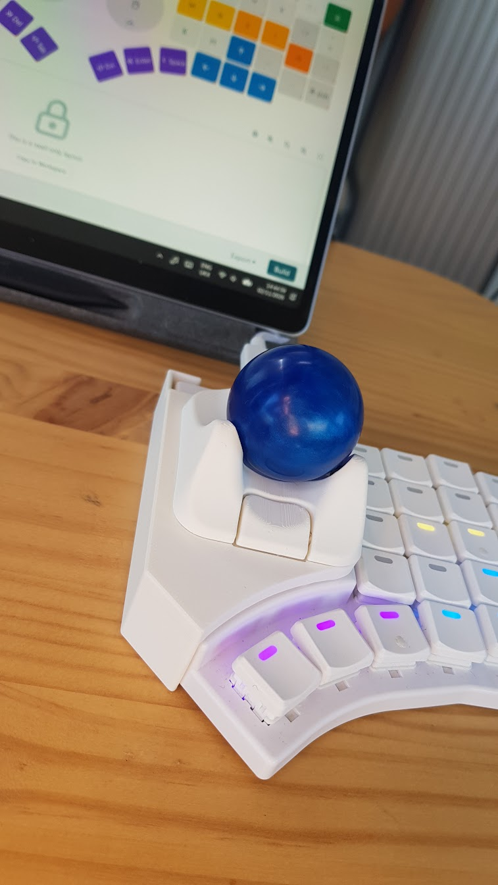

# go60_nano2

Modified [Ploopy Nano2](https://ploopy.co/nano-2/) shell to fit the right half of a [Moergo Go60](https://www.moergo.com/pages/go60) keyboard.
Based on https://github.com/ploopyco/nano-2-trackball/blob/master/hardware/mechanicals/nano2.STEP

